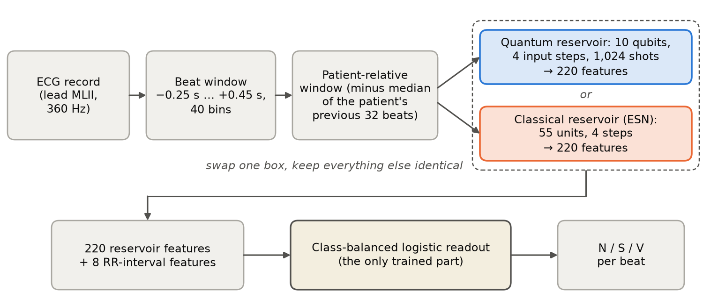
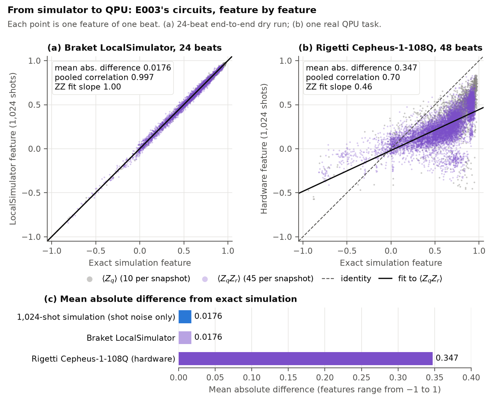
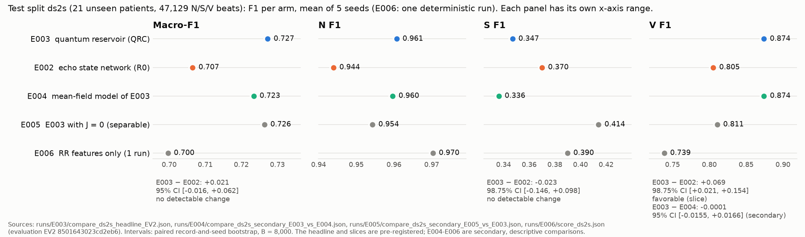
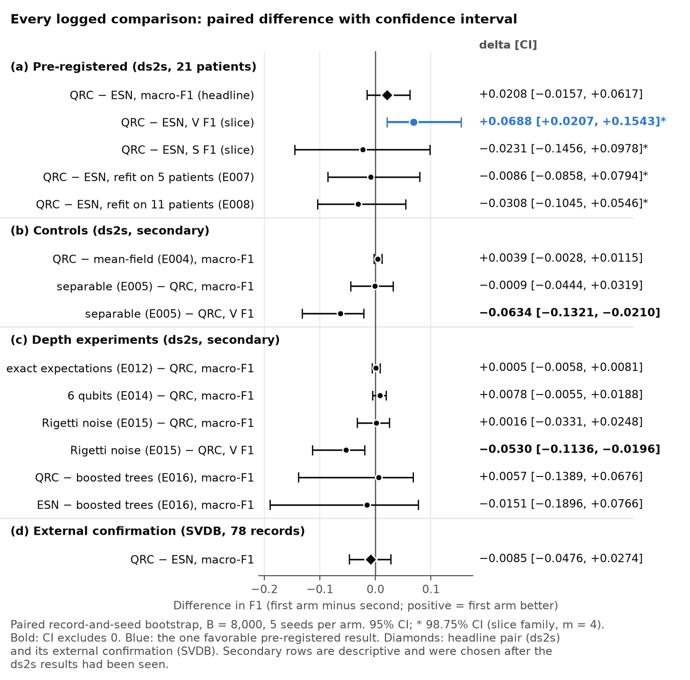
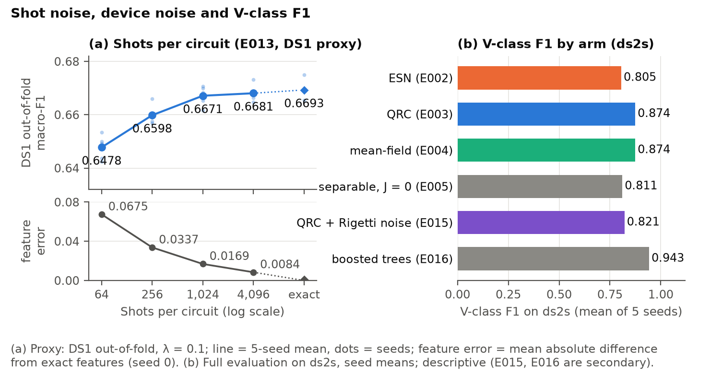

# Quantum reservoir features vs a matched classical reservoir for patient-independent heartbeat classification

A 10-qubit quantum reservoir and a matched classical reservoir, compared on ECG beats from patients neither model saw in training. The overall difference was inconclusive; a ventricular-beat improvement was reproduced by a classical mean-field model of the same circuit and was not confirmed on a second database. The circuit was also validated on Amazon Braket's simulator and run on a Rigetti quantum processor.

Quantum Healthcare Hackathon 2026, National / Hybrid track. **Easy-reading version: [`QML_Hackathon_Solution_Description.pdf`](QML_Hackathon_Solution_Description.pdf)** (the same project explained step by step, with figures).

This README is the written submission: problem, methods, the purpose of the quantum component, the shared evaluation, results, limitations and reproduction. Results carry the ID of the experiment (`E###`), anomaly (`A###`) or verification (`V###`) they come from, and [`docs/EVIDENCE.md`](docs/EVIDENCE.md) maps each number to its artifact, command, result type and evaluation version.



## Highlights

| At a glance | |
|---|---|
| Clinical task | Flag ectopic heartbeats (S, V) for patients the model has never seen |
| Test data | 21 held-out MIT-BIH patients (47,129 scored beats), plus 78 external SVDB records (184,286 beats) |
| Quantum model | 10-qubit quantum reservoir, 4 data re-uploading steps, 1,024 shots per circuit, 220 features |
| Classical baseline | Echo state network matched on input, RR features, feature count (220), readout and tuning budget (30 configurations each) |
| Controls | Classical mean-field model of the same circuit, the circuit without couplings, RR features only, tuned gradient boosting |
| Amazon Braket | Calibration-driven noise simulation for Rigetti and IQM, LocalSimulator validation of the native-gate programs, one real Rigetti Cepheus-1-108Q task (48 beats, about USD 17.71) |
| Evaluation controls | Evaluation approved before any model's test-split scoring; 13 of 15 permitted test-split scorings used, each logged with prediction hashes; two separate verifications (V004, V005); byte-for-byte reproduction from a clean environment |

### Design and checks

- **Rules fixed before tuning.** The metric, split, decision rule and a four-member slice family were fixed in `EVAL.md` before tuning, and the author approved the evaluation before any model was scored on the test split. The evaluation command enforces the rules: the pre-registered headline must be the first non-reference model scored on the test split, every test-split scoring is appended to `runs/full_eval_log.jsonl` with the hash of each prediction file, and the external database sits behind a placeholder-label preflight (Section 4).
- **Patient-independent split.** No patient appears in both training and test. We found that the standard de Chazal inter-patient split is not subject-disjoint (records 201 and 202 come from the same subject) and removed record 202 from the test split (A004). Much published quantum ECG work uses beat-level random splits instead.
- **Matched baseline.** Both arms share the input encoding, the 8 rhythm and amplitude features (the RR block), the readout dimension (220 reservoir features), the class-balanced logistic readout and the tuning budget (30 configurations chosen on training patients only). The arms differ in the reservoir and its tuned settings (figure above). Equal feature counts and budgets do not establish equal capacity (Limitation 4).
- **Controls.** A classical mean-field model of the same circuit tests the role of quantum correlations (E004); the same circuit without couplings tests the couplings (E005); an RR-only readout measures what the rhythm features give alone (E006); a tuned gradient-boosting model gives a strong non-reservoir comparison (E016); and kernel diagnostics compare the feature maps directly (E017).
- **Fewer false ventricular flags, more missed ectopic beats.** On the MIT-BIH test split the quantum reservoir roughly halves false ventricular alarms against the matched classical reservoir (709 vs 1,324 per seed) at nearly the same V sensitivity (0.949 vs 0.953), and V-class F1 rises from 0.805 to 0.874 (+0.069, 98.75% CI [+0.021, +0.154]; pre-registered slice; E003 vs E002, A015). It also misses 36 more ectopic beats per hour, and its S sensitivity is 17.4 points lower (Section 5).
- **Second database.** The frozen headline pair was run once on SVDB under a pre-registered criterion (E018); the ventricular gain was not confirmed there (Section 7).
- **Separate verification.** Two separate verification runs checked the work (V004, V005; [`VERIFICATIONS.md`](VERIFICATIONS.md)); they were part of the project's own workflow, not external peer review. From a clean environment and a fresh data download, all 10 headline prediction files and the headline table were reproduced byte for byte in 27.3 min (V005).
- **One circuit from simulation to a quantum processor.** The same circuit was taken through shot noise, calibration-driven device noise, Amazon Braket's LocalSimulator and a real Rigetti QPU, at an estimated USD 17.71 against a USD 35 cap (Amazon Braket, below).
- **Mechanism.** The primary comparison is inconclusive. The tuner chose weak couplings (J = 0.106), so the circuit stays close to a product state, and the mean-field model reproduces nearly all of the quantum arm's performance (A016).

### What is new

Our literature scan on 26 October 2026 (about 31 papers; not a systematic review) found no earlier quantum reservoir study on MIT-BIH with an inter-patient split and a matched classical reservoir. The project's design contributions are:

- **A patient-relative input for the reservoir.** Each beat window minus the element-wise median of the same patient's previous 32 windows: causal, label-free, and on the training patients it recovered most of the accuracy that raw morphology loses across patients (E001, proxy; A009).
- **The mean-field test as an attribution tool.** Running the identical gates on product states (the classical-spin control of Kornjača et al. 2024) separates "a quantum-circuit feature map helps" from "quantum correlations help". Here the two agree to within 0.0039 macro-F1, and their feature maps have linear CKA 0.986, about as close as the quantum reservoir is to a rerun of itself (0.992 with new shots, 0.989 with another reservoir seed) (E004, E017).
- **A batch-invariant finite-shot simulator.** The GPU statevector simulator draws each beat's shots from its own counter-based random stream in float64, so a beat's features do not depend on how beats are batched (A011). It matches an independent dense-matrix implementation to 4e-7 (E001).
- **Evaluation of one fixed circuit from ideal simulation to hardware.** The selected circuit is evaluated with exact expectations, with finite shots, with calibration-driven noise for two quantum processors, on Braket's LocalSimulator in native gates and on a real QPU, so each step's effect is measured on its own (E012, E013, E015, E019).
- **Beat packing on a many-qubit chip.** Five beats run side by side on disjoint 10-qubit rings of Rigetti Cepheus-1-108Q (107 qubits available at fetch time), so 48 beats × 4 snapshot circuits needed 40 circuits instead of 192 (E019).

### Amazon Braket: simulations and real hardware

We used Amazon Braket at four levels, each one checked before the next (details in Section 6.6):

1. **Device calibration → noise simulation (free).** Braket's device calibration data for Rigetti Cepheus-1-108Q and IQM Garnet (fetched 2026-10-28) set the error rates of a Pauli-trajectory simulation of the whole pipeline, on the training patients for both devices and on the test patients for Rigetti (E015). At Rigetti's rates the quantum reservoir's V F1 falls from 0.874 to 0.821.
2. **Braket LocalSimulator (free).** Our compiled native-gate programs for both devices (up to 160 two-qubit CZ gates per beat snapshot on one 10-qubit ring) reproduce our own statevector simulator to within 3.5e-6 for all four snapshots of 4 test beats. Packing beats on disjoint rings, the measurement bit order and the program-set submission format were checked. Every 10-qubit ring of the packed 24-beat plan, run separately (96 runs, 1,024 shots) and analysed with the hardware analysis code, matched the exact simulation at the level of shot noise (mean absolute feature difference 0.018, pooled correlation 0.997) (E019).
3. **Guarded submission.** A device allowlist, a 1,024-shot cap, an approval file written after the author approves, and a cost ledger that refuses any task whose estimated cumulative cost would exceed the approved cap are enforced in code (`scripts/braket_submit.py`). The estimates use the published prices; the actual bill is to be checked in AWS Billing.
4. **A real quantum processor.** One program-set task on Rigetti Cepheus-1-108Q: 48 beats, 40 circuits × 1,024 shots, about USD 17.71. The hardware features are contracted towards zero (slope 0.46; mean absolute difference from simulation 0.347, against 0.018 for shot noise), as the noise simulation predicted, and a readout trained on noiseless features does not transfer (41.7% class agreement, against an 87.5% ceiling) (E019).



**Result types used below.** *Full*: scored on the patient-held-out test split by the approved evaluation command (one command, logged). *Proxy*: training-data (DS1) cross-validation score. *Diagnostic*: tests a mechanism; no test-split score. A positive delta always means the first-named arm is better.

## Summary

**Main result.** The overall comparison was inconclusive, and no added benefit of the full quantum model over a classical mean-field model of the same circuit was detected. On the pre-registered MIT-BIH test split (ds2s), a quantum-circuit feature map improved ventricular-beat (V) F1 against the matched classical reservoir; this is the one favorable pre-registered slice. It has four qualifications: the mean-field model reaches the same V-class F1 (both round to 0.874); a post-hoc gradient-boosting model reaches a higher V-class F1 (0.943); simulated device noise lowers the quantum reservoir's V-class F1 to 0.821; and on the external SVDB database no V-class F1 gain over the ESN appeared (V F1 difference −0.003; E018), with an interval that neither confirms nor excludes a gain of the ds2s size. We do not claim a quantum advantage, a clinical benefit, or hardware feasibility. The project's contribution is a pre-registered, matched and controlled test that shows where the apparent ventricular gain comes from.

- **Task.** Flag ectopic heartbeats (supraventricular S, ventricular V) for a patient the model has never seen. MIT-BIH Arrhythmia Database, standard de Chazal inter-patient split, made strictly subject-disjoint (record 202 removed from the test split because it comes from the same subject as training record 201; A004). Test split *ds2s*: 21 patients, 47,129 scored N/S/V beats.
- **Design.** A simulated 10-qubit quantum reservoir (QRC, E003) against a matched classical echo state network (ESN, E002, the reference R0). Both are fixed reservoirs with a supervised, tuned linear readout. They share the input encoding, the 8 RR-interval features, the readout dimension (220 reservoir features), the readout model and the tuning budget (30 configurations each, chosen on training patients only). The metric, split and decision rule were declared before any model was built. The full evaluation was approved by the author before any model was scored on the test split; tuning on the training patients ran under the draft.
- **Primary result** (full, pre-registered). Inconclusive: macro-F1 0.727 (QRC) vs 0.707 (ESN), delta **+0.021, 95% CI [−0.016, +0.062]**, *no detectable change* under the pre-registered rule (E003 vs E002).
- **Ventricular beats** (full, pre-registered slice, ds2s only). Favorable against the ESN; not confirmed on SVDB (below). V-class F1 0.874 vs 0.805, **+0.069, 98.75% CI [+0.021, +0.154]**. The QRC arm roughly halves false ventricular alarms (709 vs 1,324 per seed) at nearly the same V sensitivity (0.949 vs 0.953; A015). The other three slice-family members show no detectable change.
- **Attribution** (full, secondary, descriptive). No added benefit of the full quantum model was detected against a classical mean-field model of the same circuit. QRC minus mean-field: +0.0039 [−0.0028, +0.0115]. V F1 for both rounds to 0.874; the difference is −0.0001 [−0.0155, +0.0166] (E004). Removing the circuit's couplings lowers V F1 by 0.063 [0.021, 0.132] (E005). An RR-intervals-only readout already reaches 0.700 (E006).
- **Operating point.** The QRC arm raises 198 fewer S-or-V flags per hour of recording than the ESN (608 vs 806), but misses 36 more ectopic beats per hour (93 vs 57, +63%), and its S sensitivity is 17.4 points lower (42.1% vs 59.5%). Review time was not measured; whether this trade is acceptable is not established (E003).
- **External confirmation** (full, pre-registered). Not confirmed. On SVDB (78 records, 184,286 beats), the frozen headline pair gives QRC 0.640 vs ESN 0.649, delta **−0.0085 [−0.0476, +0.0274]**, and the ds2s V-F1 gain is absent (V F1 0.570 vs 0.574) (E018).
- **Strong classical context** (full, secondary, post-hoc). The matched ESN is not the strongest classical model. Overall, gradient boosting on the same inputs shows no detectable difference from either reservoir arm, but that rests on one test patient (record 232). Its V F1 is higher than the QRC's (0.943 vs 0.874; −0.068 [−0.159, −0.031]), and without record 232 it leads by 0.087 (E016).
- **Noise and hardware.** In a device-noise simulation at Rigetti Cepheus calibration rates, the QRC's V F1 falls from 0.874 to 0.821 (secondary, ds2s; E015). On real Rigetti hardware (48 beats, 1 task, about USD 17.71), the features contract strongly towards zero, with mean absolute difference 0.35 from simulation against 0.02 for shot noise. The simulation-trained readout reproduces the simulated class on 42% of beats, against an 87.5% ceiling (diagnostic; E019).
- **Ablations** (proxy and secondary). Shot count matters little at or above 1,024 shots (E012, E013). Six qubits or a Z-only readout score at least as high on DS1 (proxy, no interval), and six qubits shows no detectable change on ds2s (E014). As a representation, the mean-field map is as close to the QRC as the QRC is to a rerun of itself (linear CKA 0.986; E017).



*Figure: F1 per arm on ds2s, seed means (E006 is one deterministic run). Built by `scripts/make_figure.py` from the logged comparison outputs.*

## AI use statement

This is a one-person project. I used Claude (Anthropic), through Claude Code, as an AI coding and research assistant throughout.

**What I did**
- Chose the healthcare problem (inter-patient ECG beat classification) and the quantum approach (a quantum reservoir with a matched classical baseline), and picked MIT-BIH and SVDB as the datasets.
- Read the background literature and decided how the comparison should be framed.
- Made every project decision. I approved the evaluation plan before any model was scored on the test patients, decided to run the additional experiments, and approved each paid Amazon Braket task with its spending cap.
- Made the submission decisions, including making the repository public and the licence.

**What Claude did**
- Wrote all of the code: data pipeline, simulators, models, evaluation, figures and build scripts.
- Ran the experiments and kept the experiment records.
- Designed the statistical evaluation under my direction: rules fixed in advance, patient-level bootstrap intervals, a correction for testing four sub-questions, and logged access to the test data.
- Explained the concepts I needed (reservoir computing, qubits and entanglement, the statistics) as the work progressed.
- Drafted the README and the PDF write-up, which I reviewed and directed.

## 1. The healthcare problem

- **Users and setting.** Ambulatory (Holter) ECG monitoring records about 100,000 beats per patient per day. Software flags beats as ectopic, and a technician or cardiologist reviews the flags:
  - supraventricular ectopic beats (S, originating in the atria);
  - ventricular ectopic beats (V, originating in the ventricles).
- **Two costs.** A missed ectopic beat can hide an arrhythmia. A false flag adds review work.
- **The limitation we target.** The model is trained on other patients and must work on a new patient without any of that patient's labels (the inter-patient setting). Performance drops sharply in this setting, especially for S beats: the reference inter-patient benchmark reports SVEB positive predictivity of 38.5% on its test set (de Chazal et al. 2004).
- **A flaw in much published quantum ECG work.** Beat-level random splits put beats of the same patient in training and test, so they measure within-patient recognition, not generalisation to a new patient. We use a patient-level split throughout.
- **Data.** MIT-BIH Arrhythmia Database v1.0.0 (PhysioNet; ODC-By 1.0):
  - 48 half-hour two-lead recordings from 47 subjects, beats annotated by cardiologists;
  - beat labels mapped to the AAMI classes N, S, V, F and Q (N: N L R e j; S: A a J S; V: V E); the classification task uses N, S and V; F and Q beats are predicted but not scored;
  - paced records excluded, as in AAMI practice.
- **Split** (EVAL.md, data card):
  - de Chazal inter-patient split: DS1 has 22 training records (50,542 N/S/V units); DS2 has 22 test records (de Chazal et al. 2004).
  - Record 202 is removed from the test set: it comes from the same subject as training record 201 (A004; PhysioNet: "Records 201 and 202 originate from the same subject").
  - Primary test split **ds2s**: 21 records, 10.53 h, 47,523 predicted beats, 47,129 scored N/S/V units (N 42,148 / S 1,781 / V 3,200).
  - The published 22-record DS2 is kept only as a secondary split for literature comparison (not scored for any model here).
- **External confirmation set.** The MIT-BIH Supraventricular Arrhythmia Database (SVDB; 78 half-hour records at 128 Hz, 184,286 units) is held back for one access-logged confirmation of the frozen headline pair (Section 7).
- **Intended outcome.** Higher macro-F1 over N/S/V on patients never seen in training, reported together with the review burden (flags and missed ectopic beats per hour) the user would experience.

## 2. The classical baseline (R0)

- **Model.** A leaky-tanh echo state network (Jaeger 2001): a fixed random recurrent network whose states feed a trained linear readout. It is the natural classical counterpart of a quantum reservoir: both are fixed dynamical systems, and in both only the readout is trained.
- **Shared preprocessing and features** (identical in every arm; declared in `EXPERIMENTS.md` before any tuning run; code `src/qhc/pipe/features.py`):
  - **Signal.** Lead MLII, selected by name (record 114 stores it in channel 1; A005), at the native 360 Hz. Non-finite samples are replaced by 0. **No digital band-pass or baseline-wander filter is applied** (an earlier planning note in `PROBLEM_BRIEF.md` said "band-pass filtered"; that was never implemented). SVDB (128 Hz, lead ECG1) is polyphase-resampled to 360 Hz and otherwise treated identically.
  - **Beat positions.** The reference beat annotations of the database (no QRS detector; see Limitations).
  - **Beat window.** −0.25 s to +0.45 s around each beat, linearly interpolated onto a fine grid and averaged into 40 bins, then minus its median and divided by its standard deviation. This per-beat normalisation removes the local offset and amplitude.
  - **Patient-relative window (the reservoir input).** The window minus the element-wise median of the same patient's previous 32 windows. It is causal and needs no labels. On DS1 it recovered most of the accuracy that raw morphology loses across patients (E001, proxy; A009). It is fed to the reservoir as 4 steps of 10 samples.
  - **RR block** (8 features, appended in every arm): pre-RR, post-RR (the next beat, allowed by the one-beat lookahead), 10-beat mean RR, log-ratios pre/avg10, post/avg10, pre/post, avg10/avg50, and the beat's amplitude relative to the previous 32 beats.
  - **Readout.** Standardised [220 reservoir features | 8 RR features], then class-balanced multinomial logistic regression with L2 penalty (λ from the grid {0.001, 0.01, 0.1, 1}); decision = argmax.
- **Tuning.** 30 configurations drawn at random from a declared search space (size, spectral radius, leak, input scale, density, bias), each scored by out-of-fold macro-F1 on DS1 only, over 5 fixed record folds. The ESN supplies the first 55 units after each of the 4 steps: 220 features.
- **Selected configuration** (E002): size 55, spectral radius 0.68, leak 0.10, input scale 0.98, density 0.054, bias 0.54, λ = 0.001. DS1 out-of-fold macro-F1 0.674 (proxy).
- **Performance on ds2s** (full; 5 seeds; E002): macro-F1 **0.7065** (seeds 0.7027-0.7162). Sensitivity / PPV / F1: N 0.907 / 0.985 / 0.944; S 0.595 / 0.269 / 0.370; V 0.953 / 0.697 / 0.805.
- **Fairness check of the baseline** (E010, proxy): the selected λ sat at the lower edge of the grid (A010). Retuning with the grid extended to 1e-5 selects the same configuration and λ (an interior optimum), and the predictions are byte-identical, so the grid edge did not handicap the baseline.
- **Verification (V004, PASS, validity only).** A separate verification run reran R0's tuning, final runs and lookahead check in the project's environment (pipeline revision `55884b1fb66732b9`) and reproduced all 5 scored ds2s prediction files byte for byte, plus every DS1 out-of-fold file and model array; it did not rescore ds2s. The clean-environment rebuild with a fresh download is separate evidence, not rerun by V004 (E002 card; `runs/phase3/clean_build_EV2.md`, `runs/phase3/reproduce_check_EV2.md`). V004 covers the validity of R0 only; it makes no quantum-arm claim. V005 (2026-10-28) later rebuilt the headline from a clean environment and a fresh data download, with no manual step beyond the README's audit-mode file copy; all 10 headline prediction files and the headline table came out byte for byte identical.

## 3. The quantum contribution

- **Why a quantum reservoir.** The limitation is cross-patient generalisation with very few trainable parameters. A quantum reservoir is a fixed physical dynamical system: its parameters are a handful of hyperparameters chosen on DS1; nothing on the quantum side is trained by gradient descent, so there are no barren plateaus or parameter-shift training costs. Its measured spin correlations form a nonlinear feature map of the patient-relative beat, and only the same supervised linear readout is fitted to the training patients. The hypothesis was that this feature map would separate ectopic from normal beats better than a classical reservoir of the same size and tuning budget. It remained a hypothesis: the results below show no performance gain that survives the classical controls and the external confirmation, and no resource benefit was measured.
- **Why a matched classical reservoir and controls.** Prior evidence calls for a strict comparison:
  - in a large benchmark of 12 quantum models on 160 datasets, out-of-the-box classical models won, and removing entanglement often did as well or better (Bowles, Ahmed & Schuld 2024);
  - with matched size and tuning effort, the quantum-reservoir advantages studied by Pandey (2026) disappear (abstract read; full text not accessed);
  - a systematic review of quantum machine learning for digital health found that "performance differentials between quantum and classical algorithms show no consistent trend to support empirical quantum utility in digital health" (Gupta et al. 2025).
  - We therefore match the classical reservoir on encoding, readout size, readout model and tuning budget, and add the classical-spin (mean-field) control of Kornjača et al. 2024 plus a no-coupling control.
- **Gap.** Our literature scan (about 31 papers screened on 2026-10-26; not a systematic review) found no quantum reservoir study on MIT-BIH that uses an inter-patient split and a matched classical reservoir.
- **Circuit** (`src/qhc/pipe/reservoirs.py`, class `QRC`): 10 qubits, starting in |0...0⟩. For each of the 4 input steps:
  1. encode the step's 10 samples as single-qubit RY rotations (angle = input scale × sample) on the current state (data re-uploading);
  2. apply `depth` layers, each of ZZ couplings exp(−i Σ J_qr Z_q Z_r) on a chain or ring with fixed random disorder in the couplings, then a transverse-field RX(h) on every qubit;
  3. read out in the Z basis: the 10 ⟨Z_q⟩ and the 45 ⟨Z_q Z_r⟩, each estimated from **1,024 shots** (finite-shot sampling is part of the headline arm; exact expectations are only an ablation, E012).
- **Feature count.** 4 snapshots × 55 = **220 features**, exactly the ESN's count. On hardware, snapshot k is a separate circuit containing input steps 1..k, so each beat needs 4 circuits of 10 qubits.
- **Simulation.** A GPU statevector simulator in PyTorch. It matches an independent dense-matrix implementation to 4e-7 (E001). Finite-shot sampling uses per-beat counter-based random streams in float64, so a beat's features do not depend on batching (A011).
- **Tuning.** The same budget and procedure as the ESN: 30 configurations of input scale, J, h, depth, topology and disorder, on DS1 only.
- **Selected configuration** (E003): input scale 0.317, J 0.106, h 0.159, depth 2, ring, disorder 0.42, λ = 0.1. DS1 out-of-fold macro-F1 0.667 (proxy). The couplings are weak, so the state stays close to a product state, which makes the mean-field control especially informative.
- **Controls** (both reuse E003's selected configuration, with no tuning of their own; EVAL.md rule 7):
  - **Mean-field model (E004).** The same gates on product states: each qubit is a Bloch vector, each ZZ gate becomes a Z rotation driven by the neighbours' ⟨Z⟩, ⟨Z_q Z_r⟩ is the product of single-qubit values, and the same 1,024-shot sampling is applied. A classical computer evaluates it in time linear in the number of qubits. It equals the exact statevector QRC at J = 0 to 3.5e-6.
  - **Separable circuit (E005).** The same circuit with J = 0: no couplings, no entanglement.
  - **RR only (E006).** The shared readout on the 8 RR features alone.
- **Hardware resources (prospective arithmetic; nothing measured).** 4 snapshot circuits × 1,024 shots = 4,096 shots per beat. Scoring all 47,523 ds2s beats for one seed would take about 194.7 million shots. At about 100,000 beats per patient-day, one Holter day would need about 410 million shots, about USD 174,000 at Rigetti's on-demand price of USD 0.000425 per shot (checked 2026-10-28; task fees excluded; without beat packing). The longest snapshot circuit has 80 logical ZZ interactions (2 layers × 10 ring edges × 4 steps) before compilation to native gates, and the 4 circuits of a beat have 200 in total. Actual cost, latency and power depend on compilation, connectivity, batching and queueing, none of which has been measured. A 10-qubit statevector has only 1,024 amplitudes, so this study makes no claim of computational advantage.

## 4. Fair evaluation

- **Pre-registration.** `EVAL.md` fixed the metric, split, units, comparison procedure, decision rule, slice family and access rules before tuning began (draft r5). The metric and split had been declared earlier, before any model was built. Both arms were tuned and their test predictions written under that draft (19:11-19:21 on 2026-10-26). The author approved it unchanged as EV1 at 21:26 UAE, before any model's test-split scoring, and then EV2 (22:14), which adds guard fixes only; scorer, units, metric, split and thresholds are unchanged. Evaluation code revision `8501643023cd2eb6`, 43 fixture tests.
- **Matched-baseline rules** (pre-registered): same pipeline, readout dimension and readout grid; equal tuning budget (N = 30 per arm, same random-search procedure and seed scheme); the headline pair named before the run; the first non-reference model scoring of the test split must be that headline (enforced by the command).
- **Metric.** Macro-F1 over N/S/V on ds2s units, beats pooled across records, per seed, averaged over 5 seeds per arm. Secondary metrics for every arm: per-class sensitivity/PPV/F1, de Chazal's VEB and SVEB measures, S and V AUPRC, and review burden per hour (S-or-V flags, normal beats flagged, missed ectopic beats).
- **Uncertainty.** Paired two-level bootstrap: records resampled jointly for both arms, seeds resampled within each arm; 8,000 replicates. It accounts for beats within a patient being correlated. The intervals are conditional on the fixed training set (DS1), the selected configurations and the seeds.
- **Decision rule for the headline** (fixed in advance). *Favorable* only if delta ≥ +0.02, the 95% CI lower bound > 0, and the delta stays > 0 without record 232 (A001). *Unfavorable* if the CI upper bound < 0. Otherwise *no detectable change*, which means insufficient evidence, not equivalence.
- **Slice family.** Four members fixed in advance and tested at 98.75% (Bonferroni): S-F1 and V-F1 of the headline comparison, and macro-F1 after refitting both arms' readouts on 5 and on 11 training patients. A slice is favorable if its CI lower bound is > 0.
- **Secondary comparisons.** The controls (E004-E006) and all Section 6 comparisons are `secondary`: descriptive intervals, never part of the headline or the slice family. Every one is reported.
- **Access rules.**
  - Training, tuning and every selection used DS1 only.
  - Every test-split scoring is appended automatically to `runs/full_eval_log.jsonl`, with the code revision and the hash of every prediction file; at most 15 scorings are allowed without the author's approval.
  - **Test-split scorings used: 13 of the 15 permitted** (`runs/full_eval_log.jsonl`, 18 lines). Seven came before the experiments of Sections 6 and 7: the headline (EV1, rerun identically under EV2), E004, E005, E006, E007 and E008. Then 1 SVDB confirmation (E018) and 5 Section 6 secondaries: E012, E014-n6, E015-Rigetti, E003 vs E016 and E002 vs E016. The repeat headline under EV2 is counted. The log's other 5 lines are scorings of two fixed reference rules made on 2026-10-26 before the evaluation was approved; under EVAL.md rule 5 they do not count. The SVDB access is counted both here and against its own cap of 2 (1 used).
  - SVDB has its own cap of 2 accesses (the confirmation plus one repair), with a placeholder-label preflight and an immutable report per access.
- **Lookahead check.** The decision boundary for beat i is max(next beat, t_i + 1 s). Every reservoir arm (E002-E005, and both arms of E007 and E008) passed a full-pipeline check that replaces the signal after that boundary and requires the beat's prediction to be unchanged (731 DS1 beats, 0 violations). The shared features, including the RR block used alone by E006, passed the same check at the feature level.
- **Verification.** R0's validity was verified in a separate verification run (V004, PASS; scope in Section 2).
- **Final verification (V005, PASS).** A separate verification checked the final package on 2026-10-28 ([`VERIFICATIONS.md`](VERIFICATIONS.md)). For E018, all 10 ds2s self-check hashes and all 10 SVDB prediction files were regenerated byte for byte; for Section 6, the 15 ds2s prediction files of E014-n6, E015-Rigetti and E016 were regenerated byte for byte. The 7 logged deltas, intervals and outcomes match the decision rule, the guard sequence and the access log are intact, and the clean-environment, fresh-download rebuild passed. V005 also checked this README's claims against the logged results: the first check found one inaccurate statement and two overstatements, and a re-check found one wrong number; all were corrected, and the final check passed.

## 5. Results on ds2s (all simulated)

Tables: `runs/tables/*.md`. Figure: top of this README.

| Comparison | Arms | Macro-F1 | Delta [CI] | Outcome | Type | Source |
|---|---|---|---|---|---|---|
| **Headline** | QRC vs ESN (R0) | 0.7273 vs 0.7065 | **+0.0208 [−0.0157, +0.0617]** (95%); without 232: +0.0460 | no detectable change (CI includes 0) | full, pre-registered | E003 vs E002 |
| Slice: V-F1 | QRC vs ESN | V F1 0.874 vs 0.805 | **+0.0688 [+0.0207, +0.1543]** (98.75%) | favorable | full, slice | E003 vs E002 |
| Slice: S-F1 | QRC vs ESN | S F1 0.347 vs 0.370 | −0.0231 [−0.1456, +0.0978] (98.75%) | no detectable change | full, slice | E003 vs E002 |
| Slice: refit on 5 training patients | QRC vs ESN, readouts refitted | 0.6898 vs 0.6984 | −0.0086 [−0.0858, +0.0794] (98.75%) | no detectable change | full, slice | E007 |
| Slice: refit on 11 training patients | QRC vs ESN, readouts refitted | 0.6944 vs 0.7253 | −0.0308 [−0.1045, +0.0546] (98.75%) | no detectable change | full, slice | E008 |
| Control: quantum vs mean-field | QRC vs classical mean-field model of the same circuit | 0.7273 vs 0.7234 | +0.0039 [−0.0028, +0.0115] (95%); V F1 −0.0001 [−0.0155, +0.0166] | no detectable change | full, secondary | E003 vs E004 |
| Control: separable minus quantum | QRC with J = 0 (first) vs QRC | 0.7264 vs 0.7273 | −0.0009 [−0.0444, +0.0319] (95%); V F1 **−0.0634 [−0.1321, −0.0210]**; S F1 +0.0671 [−0.0139, +0.1308] | no detectable change overall | full, secondary | E005 vs E003 |
| Control: rhythm only | readout on the 8 RR features | 0.6997 (S F1 0.390, V F1 0.739) | single deterministic run, no interval | descriptive | full, `score` | E006 |



*Figure: every logged comparison on one axis (difference and interval; 98.75% for the slice family, 95% otherwise). Built by `scripts/make_report_figures.py` from the logged comparison outputs.*

**Where the V gain comes from (A015).** The QRC arm's V false positives fall from 1,324 to 709 per seed, mostly normal beats in records with few or no V beats (117, 222, 105, 111, 212) and S beats in record 232, while V true positives are unchanged (3,036 vs 3,050). V PPV is 0.811 vs 0.697 at V sensitivity 0.949 vs 0.953. V AUPRC is 0.955 vs 0.918, +0.036 [−0.001, +0.138] (descriptive). Per record, among the 9 records with at least 10 V units, the QRC arm has the higher V F1 in 5. The largest loss is record 105 (−0.167, 41 V units), and three records (200, 214, 221) are within ±0.0015 (A015).

**Where the S side loses (A001, A015).** Record 232 holds **1,381 of the 1,781 ds2s S units (77.5%)**, so S metrics on this split largely measure one patient. The QRC arm finds 310 fewer S beats per seed than the ESN, 288 of them in record 232 (493 vs 781 of 1,381). Leaving out any one record keeps the headline delta positive (+0.011 without record 213 to +0.046 without 232), which does not change the primary interval.

**Operating point and review burden** (seed-averaged, per hour of recording, 10.53 h; E003 card; descriptive):

| Per hour | ESN (E002) | QRC (E003) | QRC − ESN |
|---|---:|---:|---:|
| S-or-V flags | 806 | 608 | −198 |
| Normal beats flagged | 374 | 217 | −157 |
| Missed ectopic beats (S or V predicted N) | 57 | 93 | +36 (+63%) |
| S sensitivity | 59.5% | 42.1% | −17.4 points |
| V sensitivity | 95.3% | 94.9% | −0.4 points |

Paper-compatible measures (de Chazal et al. 2004 definitions; E003 card): VEB Se 0.949 / +P 0.811 (ESN 0.953 / 0.697); SVEB Se 0.421 / +P 0.294 (ESN 0.595 / 0.268). These are not like-for-like with published results: our test split drops record 202 (A004) and the published 22-record DS2 was not scored.

Fewer flags at this operating point come with more missed ectopic beats. Review time was not measured, and no operating point was chosen for a clinical target; this table describes the trade-off and does not establish a workflow benefit.

**What is quantum (A016).**
- The mean-field model reproduces the QRC to within +0.0039 macro-F1 overall, with V F1 values that both round to 0.874 (difference −0.0001 [−0.0155, +0.0166]) and nearly equal review burden (615 vs 608 flags per hour). **No added benefit of the full quantum model was detected against mean-field.** A confidence interval that includes zero does not establish equivalence, so we do not claim that quantum correlations contribute nothing; we claim that this benchmark detected no contribution beyond the mean-field model.
- Removing the couplings (E005) lowers V F1 and raises S F1, with macro-F1 essentially unchanged: in this configuration the couplings change the class trade-off rather than improve every aspect. The tuner selected J = 0.106, at the lower end of its search range U[0.1, 1.5], and the J = 0 variant scored higher on DS1 than the selected J (0.679 vs 0.667; E005, proxy).
- Consistent with Bowles et al. 2024 and with the weak couplings the tuner chose (J = 0.106), the V-class gain is best described as coming from a coupled spin-model feature map that a classical computer evaluates cheaply.
- The RR-only readout (0.700) is close to the ESN overall (0.707), so most of the performance comes from rhythm features; the reservoirs add mainly on the V class.

**Fairness checks.**
- Extending the readout grid to 1e-5 changes neither arm's selection; predictions are byte-identical (E010, E011; proxy; A010 resolved).
- On DS1 the QRC features give fewer V false positives than the ESN at every λ of the grid, so the V difference is not a regularisation artefact on DS1 (E009, diagnostic). On the S side, much of the difference comes from the QRC's stronger selected λ.
- The DS1 tuning scores were computed with float32 code before a float64 switch made outputs batch-invariant; retuning in float64 selects the same configurations (A011).

## 6. Additional experiments (declared after the headline results)

Declared in `EXPERIMENTS.md` (2026-10-28 ~18:50 UAE) before any model run (only the free calibration fetch, device search and SVDB feature build started earlier, 18:45-18:48). They reuse E003's selected configuration unless stated. Every ds2s comparison in this section was chosen after the ds2s headline and control results had been seen, so it is a post-hoc, **secondary and descriptive** result that cannot change the inconclusive primary result or the mean-field attribution. New code is in `src/qhc/p4/`; the evaluation code and the existing pipeline were not edited.

### 6.1 Finite shots vs exact expectations (E012, E013)
- **E012** (proxy on DS1; one full secondary ds2s comparison E012 vs E003): E003's configuration with exact expectation values instead of 1,024 shots, λ fixed at 0.1. It isolates whether shot noise acts as a regulariser or as a cost.
- **E013** (proxy, DS1 only): shot sweep {64, 256, 4,096} at E003's configuration (1,024 is E003; exact is E012). Declared prediction: flat from 1,024 shots upward, lower at 64.

**Result (E012).** Proxy (DS1 out-of-fold, 5 seeds): 0.6693 with exact expectations vs 0.6671 with 1,024 shots (+0.0022, inside the seed spread). Full, secondary, descriptive (ds2s): **E012 vs E003 +0.0005 [−0.0058, +0.0081]**, no detectable change; per class N +0.001, S −0.003, V +0.004, all CIs include 0. The exact and finite-shot arms agree on 98% of ds2s predictions. At 1,024 shots, shot noise has no measurable effect on test performance. The full-pipeline lookahead check passed (731 beats, 0 violations).

**Result (E013)** (proxy, DS1 out-of-fold, 5-seed mean macro-F1 at λ = 0.1; feature error = mean absolute difference from exact features).

| Shots per circuit | 64 | 256 | 1,024 (E003) | 4,096 | exact (E012) |
|---|---:|---:|---:|---:|---:|
| DS1 OOF macro-F1 | 0.6478 | 0.6598 | 0.6671 | 0.6681 | 0.6693 |
| Feature error | 0.0675 | 0.0337 | 0.0169 | 0.0084 | 0 |

The declared prediction held: flat from 1,024 shots upward, lower at 64 (−0.019). Feature error halves with each 4× increase in shots (1/√shots). Re-selecting λ changes no row by more than 0.0012.

### 6.2 Qubit count and readout size (E014)
- **E014** (proxy on DS1; one full secondary ds2s comparison for one variant): qubit count n ∈ {6, 8, 12} (each 10-sample input step linearly resampled to n points; ring of n qubits; Z + ZZ readout, K = 84, 144 and 312 features), and n = 10 with Z-only readout (K = 40). K changes, so these are ablations, not members of the matched headline search. The variant with the highest 5-seed DS1 out-of-fold macro-F1 among the qubit-count variants gets the ds2s comparison against E003 (DS1-only selection rule, declared in advance).

**Result (E014).** Proxy (DS1 out-of-fold, 5-seed mean; E003 with 10 qubits and K = 220 scores 0.6671): 6 qubits (K = 84) **0.6803**; 8 qubits (K = 144) 0.6673; 12 qubits (K = 312) 0.6635; 10 qubits with Z-only readout (K = 40) 0.6776. The 6-qubit variant was selected by the declared rule. Full, secondary, descriptive (ds2s): **E014-n6 vs E003 +0.0078 [−0.0055, +0.0188]**, no detectable change; without record 232 +0.0004; per class S +0.028 [−0.009, +0.057], V −0.007 [−0.027, +0.014].
- More qubits did not help, and dropping every ZZ correlator (Z-only) did not hurt on DS1 (A020). This is consistent with the mean-field finding: the two-qubit correlators add little here.
- Caveat: changing the qubit count also resamples each 10-sample input step to n points, so qubit count and input resolution are confounded.
- Check: at n = 10 the generalised simulator reproduces the headline simulator bit for bit (3,186 DS1 beats); lookahead check passed.

### 6.3 Device-noise simulation (E015)
- **E015** (proxy on DS1; one full secondary ds2s comparison E015-Rigetti vs E003): E003's circuit simulated with stochastic Pauli trajectories: depolarising error after every single-qubit gate, two-qubit depolarising error after each of the 2 native two-qubit gates per ZZ interaction, and readout assignment error on every sampled bit. Rates come from the device calibration returned by Amazon Braket for Rigetti Cepheus-1-108Q and IQM Garnet at fetch time. The readout is trained on noisy DS1 features. Declared limitations: no idle T1/T2 decay, no crosstalk, no routing (a 10-qubit ring is assumed embeddable). Declared prediction: at current two-qubit error rates the ZZ correlators shrink and V F1 moves towards the separable control's.

**Result (E015).** Error rates from the free Braket calibration data (fetched 2026-10-28 14:45 UTC; medians over each chip): Rigetti Cepheus-1-108Q: single-qubit error 0.0030, CZ error 0.0117, readout error 0.031; IQM Garnet: 0.0006, 0.0045, and 0.010 / 0.027 (0→1 / 1→0). Simulated with 32 trajectories × 32 shots per circuit.
- **Proxy (DS1 out-of-fold, 5 seeds):** Rigetti noise 0.6463 (−0.021 vs E003, every seed lower), IQM noise 0.6527 (−0.014). The declared prediction failed: V F1 fell to 0.699 (Rigetti) and 0.717 (IQM), below both the noiseless QRC (0.742) and the separable control (0.756) (A021).
- **Full, secondary, descriptive (ds2s):** **Rigetti-noise vs E003 +0.0016 [−0.0331, +0.0248]**, no detectable change overall; without record 232 −0.018. Per class: **V F1 −0.053 [−0.114, −0.020]** (0.821 vs 0.874), S F1 +0.058 [−0.036, +0.121]. The noise-aware readout trades V for S, as the no-coupling control did (E005).
- **Consequence:** at Rigetti's calibrated rates, the QRC's V F1 falls from 0.874 to 0.821, against the ESN's 0.805 (an unpaired, descriptive comparison), so most of the headline's favorable V-slice margin does not survive device noise in this simulation. The simulation omits idle decay, crosstalk and routing, so real hardware is expected to be worse.
- A readout trained on noiseless features and applied to noisy ones collapses (DS1 out-of-fold, seed 0: 0.278 Rigetti, 0.498 IQM, against 0.668): a hardware deployment would need a readout trained on hardware-like features.


- Checks: with all error rates at 0 the noise simulator reproduces the headline simulator bit for bit; the ⟨Z⟩ and ⟨ZZ⟩ magnitudes shrink step by step with circuit depth as expected; lookahead check passed.

### 6.4 A strong non-reservoir classical model (E016)
- **E016** (proxy on DS1; two full secondary ds2s comparisons, E003 vs E016 and E002 vs E016, positive = the reservoir arm is better): scikit-learn `HistGradientBoostingClassifier` on the reservoirs' inputs [patient-relative window (40) | RR block (8)], class-balanced, with its own DS1 budget of 30 configurations (learning rate, leaf nodes, leaf size, L2, iterations, feature fraction) and a 20-minute search cap. Chosen after the ds2s results, because no strong non-reservoir classical model had been built (the progress review's first recommendation); disclosed as post-hoc. It gives context; it does not replace the matched ESN as the comparator.

**Result (E016).** Selected on DS1 (30 configurations, 500 s): learning rate 0.024, 127 leaf nodes, 300 iterations; 5-seed DS1 out-of-fold 0.6702 (E003 0.6671, E002 0.6620; proxy). The 0.674 and 0.667 quoted in Sections 2 and 3 are the seed-0 tuning scores. Full, secondary, descriptive (ds2s; positive = the reservoir arm is better):

| Comparison | Macro-F1 | Delta [95% CI] | Without record 232 | V F1 | S F1 |
|---|---|---|---:|---|---|
| QRC (E003) vs boosted trees (E016) | 0.7273 vs 0.7216 | +0.0057 [−0.1389, +0.0676] | **−0.0869** | 0.874 vs **0.943**: −0.068 [−0.159, −0.031] | 0.347 vs 0.246: +0.101 [−0.307, +0.270] |
| ESN (E002) vs boosted trees (E016) | 0.7065 vs 0.7216 | −0.0151 [−0.1896, +0.0766] | **−0.1329** | 0.805 vs 0.943: −0.137 [−0.267, −0.067] | 0.370 vs 0.246: +0.124 [−0.369, +0.384] |

Both comparisons show no detectable change overall, but that result rests on record 232: the boosted trees rarely predict S (655 of 47,523 ds2s beats, against 2,585 for the QRC arm), so they lose the S beats of that one patient. Pooled over the other 20 records they lead by 0.087 (against the QRC) and 0.133 (against the ESN), though not in every record (A019). **On the V class, the class on which the QRC beat the ESN, the boosted trees beat both reservoir arms, with 95% CIs that exclude 0.** The QRC's V-class result is therefore a result against a matched reservoir, not against the strongest classical model we built. Lookahead check passed (731 beats, 0 violations).

### 6.5 Representation diagnostic (E017)
- **E017** (diagnostic, DS1 only, no test labels): seed-0 DS1 features of the QRC (finite-shot and exact), mean-field, separable, ESN and RR-only maps, standardised, with linear kernels (the readout is linear). Centered kernel-target alignment per DS1 record and pooled; linear CKA between maps; the geometric difference of Huang et al. 2021 between the QRC kernel and each classical kernel on a seeded subsample of 2,000 beats. Question: are the QRC and mean-field feature maps near-identical as kernels, and for which patients does each map align with the labels?

**Result (E017)** (diagnostic, DS1 only; reservoir blocks alone, adding the RR block changes values by ≤ 0.02).
- **Linear CKA** (1 = the same representation up to rotation and scale): QRC vs mean-field **0.986**; QRC vs ESN 0.525; QRC vs separable 0.510. For scale: the QRC against itself with a new shot seed 0.992, with another reservoir seed 0.989; exact QRC vs exact mean-field 0.994.
- **Kernel-target alignment** (one-hot N/S/V / V-vs-rest): QRC 0.175 / 0.203, mean-field 0.159 / 0.184, ESN 0.246 / 0.248, separable 0.330 / 0.372, RR 0.181 / 0.158; S-vs-rest ≤ 0.04 for every map. Per record, the QRC beats the mean-field map in 13 of 17 records, about as often as it beats its own second seed (14 of 17). Alignment does not predict readout F1 here: the separable map aligns best but has the lowest ds2s V F1.
- **Geometric difference** g(K_C‖K_QRC) (Huang et al. 2021) at regulariser 1e-3 / 1e-2 / 1e-1: mean-field 9.6 / 7.4 / 3.3, which is the same scale as a shot-noise replicate of the QRC itself (10.5 / 7.9 / 3.4); ESN 35 / 21 / 10; separable 27 / 23 / 13. No pair meets the paper's rule for choosing the regulariser, so these are descriptive.
- As a representation, the mean-field map is as close to the QRC as the QRC is to a rerun of itself, which supports the mean-field finding at the feature level (A016). This is a statement about linear kernels on measured expectations on DS1; it cannot establish or exclude a quantum advantage.

### 6.6 Amazon Braket: simulations, validation and hardware features (E015, E019)
- **E019** (diagnostic, label-free): E003's seed-0 circuits for a small seeded draw of ds2s beats (stratified by the simulated predicted class, fixed before any task), 4 snapshot circuits per beat, several beats packed on disjoint 10-qubit rings of one device per task. Measured: per-feature correlation and mean absolute difference between hardware features and the finite-shot and exact simulations, and agreement of the seed-0 readout's predicted class with the simulation's. No macro-F1 is claimed. Every task needs the author's approval with a cost estimate (cap USD 35); the device allowlist (Rigetti Cepheus-1-108Q and IQM Garnet only), the shot cap and the cost ledger are enforced in code (`scripts/braket_submit.py`, run in a separate Braket SDK environment; circuit building and analysis in `src/qhc/p4/braket_hw.py`).

**Braket simulations before any paid task** (E019 mechanism checks; free; `runs/E019/validation/`, `runs/E019/summary.json`). Amazon Braket was first used without cost, at three levels:
- **Calibration-driven noise simulation.** The error rates of E015 (Section 6.3) come from the device calibration that Braket returns for Rigetti Cepheus-1-108Q and IQM Garnet; the Pauli-trajectory simulation then runs the full pipeline on DS1 for both devices and on ds2s for Rigetti.
- **Native-gate programs on the Braket LocalSimulator** (`braket_sv`, amazon-braket-sdk 1.127.6). E003's snapshot circuits were compiled to each device's native gates on pinned physical qubits (verbatim programs, up to 160 CZ and 995 single-qubit gates per beat snapshot on one 10-qubit ring; a packed hardware circuit carries up to five such rings). On the LocalSimulator they reproduce our complex64 statevector to within 3.5e-6 for all four snapshots of each of 4 test beats on both gate sets. Two beats packed on disjoint rings give the same marginals as single rings (≤ 3.1e-6). A bit-order control separates the correct order (mean absolute error 0.015-0.033 at 1,024 shots) from a fully reversed order (0.10-0.22 on the single-ring circuits; 0.038 and 0.18 on the two packed circuits).
- **End-to-end analysis check.** Each 10-qubit ring of the packed 24-beat Rigetti plan was run separately on the LocalSimulator (96 runs, 1,024 shots), written in the hardware result format and analysed with the hardware analysis code: features match the exact simulation with mean absolute difference 0.018 and pooled correlation 0.997, the level of shot noise alone. The program-set submission format was checked separately with two executables. The real fetch path was first exercised on the paid task (its first attempt failed on credentials and succeeded with the AWS profile set; E019 card).

The figure in the Highlights compares these LocalSimulator features and the hardware features with the exact simulation.

**Result** (E019; diagnostic, label-free; real hardware). The author approved Rigetti Cepheus-1-108Q, 48 beats, one task, cap USD 18. The first submission was refused by AWS before any task was created: the account lacked Braket's service-linked role, and nothing was charged. After the role was created, one program-set task ran 40 circuits × 1,024 shots, with 5 beats' circuits on disjoint 10-qubit rings per circuit, at an estimated USD 17.71. All 48 beats completed.
- **Features.** Hardware features differ from the exact simulation by a mean absolute **0.347**, against **0.018** between the 1,024-shot and exact simulations. Pooled correlation with the simulation is **0.70**, median per-feature correlation 0.53. Hardware ZZ correlators are contracted towards zero (regression slope 0.46), as the device-noise simulation predicts (E015).
- **Predictions.** The 48 beats were drawn 16 per simulated predicted class, label-free. The seed-0 readout, trained on noiseless simulated features, gives the same class on hardware as in the finite-shot simulation for **41.7%** of beats. Given the hardware's class frequencies, chance agreement would be 33.3%. The ceiling (finite-shot vs exact simulation) is 87.5%. Hardware predictions skew to S (35 of 48), the same failure E015 found when a noiseless-trained readout meets noisy features (A021, A023).
- E003's circuit runs on a current QPU, but its features are not the simulated ones. A hardware deployment would need a readout trained on hardware features, plus error mitigation. No macro-F1 is claimed; there are no readout-error corrections; it is a single task under a single calibration state.

## 7. External confirmation on SVDB (E018)

- **What it tests.** Whether the frozen headline pair (the exact DS1-trained artifacts of E003 and E002, 5 seeds each) keeps a positive macro-F1 delta on a second database: SVDB, 78 half-hour records at 128 Hz, 184,286 units, chosen by PhysioNet "to supplement the examples of supraventricular arrhythmias in the MIT-BIH Arrhythmia Database". Its S beats are spread over 73 of the 78 records (the largest holds 14.9%), so it tests S-class transfer far better than ds2s.
- **Pre-registered criterion** (EVAL.md, fixed 2026-10-26): *confirmed* if the SVDB paired delta is > 0 and its 95% CI lower bound is > 0 (two-level bootstrap over the 78 records). Result type: full (EV2, confirmation). It cannot make the inconclusive ds2s primary significant.
- **Procedure.** A predict-only path (`src/qhc/p4/predict.py`) loads each of the 10 saved headline artifacts, checks the regenerated reservoir against the saved arrays, the shot count and the configuration, and writes predictions without modifying the artifact (A018). Precondition: its ds2s self-check reproduces all 10 logged headline prediction hashes (hashes only, nothing scored). Then `qhc.evaluate compare --split svdb --role confirmation`, whose placeholder-label preflight runs before the access is logged. The access ran on 2026-10-28 (19:29-20:01 UAE).
- **Caveats.** Different sampling rate and unknown lead identity (all models face the same domain shift, so the paired delta is the confirmed quantity); possible subject overlap with MIT-BIH, which cannot be checked from the headers (A006), in which case the record bootstrap is anti-conservative.

**Result (E018)** (full, EV2, confirmation access 1 of 2; logged 19:29:19 UAE, completed 20:01:41). Precondition met: the predict-only path reproduced all 10 logged ds2s headline prediction hashes, and the 10 artifacts were not modified.

| SVDB (78 records, 184,286 units, 39.0 h) | QRC (E003) | ESN (E002) | Delta [95% CI] |
|---|---:|---:|---|
| **Macro-F1** | 0.6402 | 0.6488 | **−0.0085 [−0.0476, +0.0274]** |
| N F1 | 0.938 | 0.935 | +0.004 [−0.006, +0.014] |
| S F1 | 0.412 | 0.438 | −0.026 [−0.078, +0.024] |
| V F1 | 0.570 | 0.574 | −0.003 [−0.089, +0.073] |
| V AUPRC | 0.605 | 0.677 | −0.073 [−0.185, +0.041] |
| V sensitivity / PPV | 0.600 / 0.544 | 0.763 / 0.463 | descriptive |
| S-or-V flags per hour | 801 | 870 | descriptive |
| Missed ectopic beats per hour | 133 | 111 | descriptive |

**Outcome: not confirmed** (pre-registered: delta > 0 and CI lower bound > 0). The delta is negative whichever record is left out (−0.016 to −0.001). On SVDB the QRC arm keeps the same direction of trade-off as on ds2s (higher V PPV, lower V sensitivity, fewer flags, more missed ectopic beats), but the V-F1 gain does not reappear. The V-sensitivity gap widens from 0.4 points on ds2s to 16.3 points on SVDB, and both arms' V F1 falls to about 0.57. The SVDB V-F1 interval [−0.089, +0.073] neither confirms nor excludes a gain of the ds2s size (+0.069). Report: `runs/E018/confirm_svdb.json`; immutable archive `runs/confirmation_reports/access_1.json`. No repair access was used, because no implementation defect is known.

## 8. Limitations

1. **No quantum advantage (A016).** A classical mean-field model of the same circuit reaches nearly the same performance; no added benefit of the full quantum model was detected. The claim is a quantum-circuit feature map, not a quantum speed-up or an accuracy gain attributable to entanglement.
2. **Primary result inconclusive.** The macro-F1 delta is no detectable change. Only the V-F1 slice is favorable, and it is one of four pre-declared slice members; a favorable slice does not retroactively make the primary successful.
3. **Most of the performance comes from rhythm features.** The RR-only readout scores 0.700 against 0.707 (ESN) and 0.727 (QRC) (E006); the reservoirs add mainly on the V class.
4. **The matched ESN is not the strongest classical model.** The matched ESN is a controlled comparator; equal feature counts and budgets do not establish equal capacity. E016 tested a tuned non-reservoir model as a post-hoc, secondary comparison.
   *Result (E016):* a post-hoc gradient-boosting model on the same inputs shows no detectable overall difference from either reservoir arm, a result that rests on record 232; it has higher V F1 than both (0.943 vs 0.874 and 0.805, CIs excluding 0) and leads by 0.087-0.133 without record 232 (A019).
5. **Operating-point trade-off.** The QRC arm's fewer flags come with +36 missed ectopic beats per hour (+63%) and S sensitivity 17.4 points lower. Review time was not measured; no clinically justified operating point was set.
6. **One patient dominates the S class (A001).** Record 232 holds 1,381 of the 1,781 ds2s S units (77.5%). S metrics on ds2s largely measure one patient, and the QRC arm's S loss is concentrated there. We report the delta without 232 and the leave-one-record-out range, and do not use either to remove the observed failure.
7. **Only 21 test patients.** Many beats do not substitute for many independent patients; the record-level bootstrap is approximate and wide.
8. **Conditional on reference beat positions.** The pipeline uses the database's annotated beat positions; there is no QRS detector, so detection errors and missed beats are outside the evaluation.
9. **One-beat lookahead.** Inputs may use the next beat (latency max(1 s, next RR interval)), so this is an offline or latency-tolerant classifier, not an immediate alarm.
10. **Enriched historical benchmark.** MIT-BIH was deliberately enriched with uncommon arrhythmias (PhysioNet: pooled results "should not be interpreted as estimates of arrhythmia prevalence in a general clinical population"). The per-hour rates above are not deployment rates. Noise, lead changes, devices and patient subgroups are untested.
11. **Reduced-data slices reuse full-DS1 selections.** The 5- and 11-patient refits keep the configurations and λ selected on all of DS1 and use one fixed subset per size, so they measure readout refitting conditional on full-data model selection, without subset-selection uncertainty (E007, E008).
12. **Intervals are conditional.** They cover test records and seeds for the fixed training set, the selected configurations and the 5 seeds; they do not include the uncertainty of choosing another training cohort or repeating the model search.
13. **Post-hoc choices after seeing ds2s.** All Section 6 comparisons were chosen after the headline and control results were seen; they are secondary and descriptive. The 15-scoring cap is a workflow control, not a statistical guarantee against adaptive selection.
14. **The standard split is not subject-disjoint (A004).** Records 201 (training) and 202 (test) come from the same subject; 202 is removed from the primary test split. The published 22-record DS2 is kept only as a secondary split.
15. **Simulation only.** All scored results are simulated. The device-noise simulation omits idle decay, crosstalk and routing (E015). The one real-hardware run is a 48-beat, label-free diagnostic, and it shows the simulated features are not reproduced on the device (E019).
16. **Absolute S performance is low in both arms.** S PPV is 0.27-0.30 (E002, E003); this is a controlled quantum-vs-classical comparison, not a state-of-the-art arrhythmia classifier.
17. **Confirmation-set incident** (2026-10-26 ~17:45 UAE, before any model existed). During a test of the confirmation guard, a path-binding bug made the code open the real SVDB label file. The run failed on beat-ID validation before any metric was computed; its only output was an error giving the prediction-set size and one beat ID, both already public, and no label values or scores were displayed or stored. The bug was fixed, the guard test now asserts that the real file is never opened, and a separate review (V002) judged that SVDB is not compromised as a confirmation set (access log in `EVAL.md`; V002 in `VERIFICATIONS.md`).
18. **SVDB demo path mismatch (A017).** For SVDB, the per-record path used by the demo and the lookahead check keys each beat's shot stream by resampled 360 Hz positions, while the scored batch path uses native 128 Hz beat IDs, so an SVDB demo would not reproduce the scored SVDB predictions. No scored result is affected (MIT-BIH is natively 360 Hz, and the SVDB confirmation uses the batch path). No SVDB demo is shown; the fix is deferred.
19. **Smaller points.** The tuning scores come from float32 code before the float64 switch; retuning in float64 selects the same configurations (A011). Current MIT-BIH annotation totals differ from de Chazal's Table II by at most 2 beats per class (A008). SVDB headers carry no demographics, so subject overlap with MIT-BIH cannot be checked (A006).

## 9. Reproduction

**Environment.** Python 3.12 (tested with 3.12.10 on Windows 11; Linux is expected to work but was not tested). One CUDA GPU is recommended; the code runs on CPU, more slowly (the CPU path was not timed). Dependencies are pinned in `requirements-lock.txt`, which pulls the CUDA 12.8 build of PyTorch from PyTorch's package index. Commands below use Windows paths; on Linux use `.venv/bin/python`.

**Data.** Raw data is not in this repository. `scripts/download_data.py` downloads MIT-BIH and SVDB v1.0.0 from PhysioNet's open-data mirror and verifies every file against PhysioNet's `SHA256SUMS.txt`, whose own hash is pinned in the script. Use of the data requires the attribution in Section 11 (ODC-By 1.0).

**Setup.**
```
python -m venv .venv
.venv/Scripts/python -m pip install -r requirements-lock.txt
.venv/Scripts/python -m pip install -e .
```

**One command, fresh run** (from a fresh checkout whose `runs/` holds no E002/E003 outputs and no logged headline):
```
.venv/Scripts/python scripts/reproduce.py            # download, units, fixtures, features, tuning, final runs, lookahead checks, headline, tables
```
This repository already contains the logged headline in `runs/full_eval_log.jsonl`, and the evaluation command refuses a second headline. So, to check the results without a new test-split access, use the audit mode:

**Audit mode (no test-split scoring).** In a new directory, copy `src/`, `tests/`, `scripts/`, `pyproject.toml` and `requirements-lock.txt` from this repository, plus two read-only reference files: `runs/full_eval_log.jsonl` (the logged prediction hashes) and `runs/E003/compare_ds2s_headline_EV2.json` (the logged comparison the tables are rebuilt from). Create the venv as above, then:
```
.venv/Scripts/python scripts/reproduce.py --check     # regenerates all 10 headline prediction files and compares their hashes with the log; rebuilds runs/tables/headline_ds2s.md
```
It refuses to run where `runs/E002/tuning.jsonl` or `runs/E003/tuning.jsonl` exist, so it never overwrites this repository's history. Our own run of this check (with `--skip-data`, in a fresh venv) took 26 minutes and reproduced all 10 files and the table byte for byte (`runs/phase3/reproduce_check_EV2.md`). `--tables-only` rebuilds the table from the logged comparison.

**Individual steps** (as run for E002/E003; the per-experiment commands for E004-E011 are on the cards in `EXPERIMENTS.md` and in `docs/EVIDENCE.md`):
```
.venv/Scripts/python scripts/download_data.py                    # MIT-BIH + SVDB, SHA256-checked
.venv/Scripts/python -I -m qhc.units                             # evaluation units, label-free positions, folds, subsets
.venv/Scripts/python -I -m pytest -q                             # evaluation fixtures (43)
.venv/Scripts/python -I -m qhc.pipe.features --splits ds1 ds2s   # beat features (label-free)
.venv/Scripts/python -I -m qhc.pipe.run tune  --arm esn --exp E002
.venv/Scripts/python -I -m qhc.pipe.run tune  --arm qrc --exp E003
.venv/Scripts/python -I -m qhc.pipe.run final --exp E002 --seeds 0 1 2 3 4 --oof --splits ds2s
.venv/Scripts/python -I -m qhc.pipe.run final --exp E003 --seeds 0 1 2 3 4 --oof --splits ds2s
.venv/Scripts/python -I -m qhc.pipe.run leakcheck --exp E002 --seed 0
.venv/Scripts/python -I -m qhc.pipe.run leakcheck --exp E003 --seed 0
.venv/Scripts/python -I -m qhc.evaluate compare --split ds2s --role headline --cand runs/E003/pred_ds2s_seed0.csv runs/E003/pred_ds2s_seed1.csv runs/E003/pred_ds2s_seed2.csv runs/E003/pred_ds2s_seed3.csv runs/E003/pred_ds2s_seed4.csv --base runs/E002/pred_ds2s_seed0.csv runs/E002/pred_ds2s_seed1.csv runs/E002/pred_ds2s_seed2.csv runs/E002/pred_ds2s_seed3.csv runs/E002/pred_ds2s_seed4.csv --cand-id E003 --base-id E002 --out runs/E003/compare_ds2s_headline.json
.venv/Scripts/python -I -m qhc.pipe.tables --cmp runs/E003/compare_ds2s_headline.json --out runs/tables/headline_ds2s.md
.venv/Scripts/python -I -m qhc.pipe.demo --exp E003 --seed 0 --record 232 --start 300 --seconds 20 --out runs/demo/qrc_E003_rec232.png
.venv/Scripts/python -I scripts/make_figure.py                   # docs/figures/ds2s_per_class_f1.png from the logged outputs (no label access)
```
The headline `compare` refuses to run twice with different models and refuses if any other model was scored on the test split first, so a rerun from scratch needs an empty `runs/full_eval_log.jsonl`. The demo (`runs/demo/qrc_E003_rec232.png`) shows the QRC arm's predicted classes and S/V probabilities on 20 s of test record 232; it shows predictions only, no reference labels.

**Figures and the PDF write-up** (no label access; the PDF needs Google Chrome or Microsoft Edge installed):
```
.venv/Scripts/python -I scripts/make_report_figures.py         # docs/figures/fig_*.png from the logged outputs
.venv/Scripts/python -I scripts/build_report.py                # QML_Hackathon_Solution_Description.pdf from docs/report/report.html
```

**Expected runtime.** On one RTX 6000 Ada: tuning about 6 min (ESN) and 10 min (QRC); final runs seconds per seed; a 5-seed comparison with 8,000 bootstrap replicates about 5-12 min on one CPU core.

## 10. Code layout

- `src/qhc/` (top level): the evaluation: `evalspec` (splits, classes, rules), `units` (evaluation units, label-free positions, folds, subsets), `scorer`, `evaluate` (the guarded `compare`/`score` command and access logs), `leakcheck`. Its hash is the evaluation revision in `EVAL.md`.
- `src/qhc/pipe/`: the models: `features` (beat windows, patient-relative windows, RR block), `reservoirs` (GPU statevector QRC, mean-field model, ESN), `readout`, `run` (tuning, final runs, controls, reduced-data refits, lookahead check), `tables`, `demo`.
- `src/qhc/p4/`: code for the later experiments (Sections 6 and 7), added without editing the two packages above: `predict` (predict-only path from saved artifacts, A018), `ablate` (shots, exact expectations, qubit count, readout size), `noise` (device-noise trajectories), `boost` (gradient-boosting context model), `kernels` (alignment, CKA, geometric difference), `braket_hw` (E019: label-free beat draw, circuit packing, cost plan and analysis; submission is `scripts/braket_submit.py`).
- `scripts/`: `download_data.py`, `reproduce.py`, `make_figure.py`, `make_report_figures.py` (figures for the README and the PDF), `build_report.py` (the PDF, from `docs/report/report.html`), and `braket_submit.py` (E019 task submission, run only in the separate `.venv-braket` environment with the author's approval per task). The figure scripts read only logged outputs and no label files.
- `tests/test_scorer.py`: the 43 evaluation fixtures.
- `runs/`: every experiment's outputs (`runs/E###/`), the test-split access log `runs/full_eval_log.jsonl`, tables `runs/tables/`, verification outputs `runs/V###/`, the demo `runs/demo/`. Raw and processed data (`runs/data/`) are excluded from the repository and rebuilt by the commands above.
- Project records: `EVAL.md` (evaluation specification and change history), `EXPERIMENTS.md` (one card per experiment), `ANOMALIES.md`, `VERIFICATIONS.md` (verification reports), `IDEAS.md`, `PROBLEM_BRIEF.md`, `PROGRESS_REVIEW_2026-10-28.md` (a progress review whose claim corrections are applied here). The first draft of the write-up is kept in `docs/history/WRITEUP_2026-10-26.md`.

## 11. Data, licences and references

**Code licence.** MIT (`LICENSE`).

**Data licence and attribution.** Both databases are open access on PhysioNet under the Open Data Commons Attribution License v1.0. The raw databases are not redistributed here; `scripts/download_data.py` fetches them. Derived files under `runs/` (feature arrays, prediction files, an archived snapshot of an earlier units build) are shared under the same licence and attribution. Required citations, as given on the PhysioNet pages (accessed 2026-10-28):
- MIT-BIH Arrhythmia Database: Moody GB, Mark RG. The impact of the MIT-BIH Arrhythmia Database. IEEE Eng in Med and Biol 20(3):45-50 (May-June 2001). Dataset: Moody, G., & Mark, R. (2005). MIT-BIH Arrhythmia Database (version 1.0.0). PhysioNet. RRID:SCR_007345. https://doi.org/10.13026/C2F305
- MIT-BIH Supraventricular Arrhythmia Database (https://physionet.org/content/svdb/1.0.0/, DOI 10.13026/C2V30W): Greenwald SD. Improved detection and classification of arrhythmias in noise-corrupted electrocardiograms using contextual information. Ph.D. thesis, Harvard-MIT Division of Health Sciences and Technology, 1990.
- PhysioNet (standard citation): Pollard, T., Moody, B. E., Lehman, L., Gow, B., Fernandes, C., Xie, C., Johnson, A., Mark, R. G., & Heldt, T. (2026). PhysioNet as a global platform for biomedical research. Nature Health. https://doi.org/10.1038/s44360-026-00096-z

**References.**
- Bowles, J., Ahmed, S., Schuld, M. (2024). Better than classical? The subtle art of benchmarking quantum machine learning models. arXiv:2403.07059. doi:10.48550/arxiv.2403.07059
- de Chazal, P., O'Dwyer, M., Reilly, R. B. (2004). Automatic classification of heartbeats using ECG morphology and heartbeat interval features. IEEE Transactions on Biomedical Engineering. doi:10.1109/tbme.2004.827359 (open-access copy: http://hdl.handle.net/2262/17623)
- Gupta, R. S., Wood, C. E., Engstrom, T., Pole, J. D., Shrapnel, S. (2025). A systematic review of quantum machine learning for digital health. npj Digital Medicine. doi:10.1038/s41746-025-01597-z
- Huang, H.-Y., Broughton, M., Mohseni, M., Babbush, R., Boixo, S., Neven, H., McClean, J. R. (2021). Power of data in quantum machine learning. Nature Communications. doi:10.1038/s41467-021-22539-9
- Jaeger, H. (2001). The "echo state" approach to analysing and training recurrent neural networks. GMD technical report (report number not confirmed).
- Kornjača, M. et al. (2024). Large-scale quantum reservoir learning with an analog quantum computer. arXiv:2407.02553. doi:10.48550/arxiv.2407.02553
- Pandey, T. (2026). When classical baselines are tuned as carefully as the quantum model, does quantum reservoir computing still win? arXiv:2607.09905. doi:10.48550/arxiv.2607.09905 (abstract read; full text not accessed)
